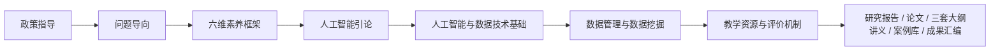

# “智治融合”AI 核心素养培育教改项目任务拆解（WBS）

> - **版本**：v0.1（初稿，供项目组评审）
> - **编制日期**：2026-11-10
> - **编制依据**：①《教改项目内容.pdf》（项目论证：项目简介、现状与背景、研究内容/目标/问题/特色、预期成果、工作计划）；②《人工智能与数据技术基础》2026—2027 学年秋季教学大纲；③《数据管理与数据挖掘》2026 年秋季学期教学大纲。
> - **基线**：截至 2026-11-10，仓库 `main` 仅有上述 PDF 与两份大纲；《人工智能引论》课程材料、三套讲义、案例库、评价工具、研究报告均未入库。

**使用说明**

- 任务编号按“工作包.序号”编排（如 `2.1`）；“依赖”列中的编号即前置任务。
- “时间”为按项目申报书五个阶段推算的建议窗口，须与教务排期、课程实际开课学期核对后固化。
- 每个任务以“交付物”作为完成标志；验收要点写在每个工作包之后，交付物清单与总体验收口径见第七节。
- 本拆解不替代项目申报书与正式课程大纲；两者冲突时以正式文件为准。

---

## 一、项目目标与成果基线

### 总目标

以《人工智能引论》《人工智能与数据技术基础》《数据管理与数据挖掘》三门数智基础类课程为载体，把“智能技术学习—治理场景理解—善治价值判断”贯通起来，围绕“技术理解、数据思维、模型认知、人机协同、价值判断、责任治理”六个维度重构课程目标、教学内容与评价方式，形成可实施、可评价、可推广的“智治融合”AI 核心素养培育路径。

### 项目逻辑（PDF 第 1 页图 1）

政策指导 → 问题导向（重工具·轻理解；重应用·轻治理；重操作·轻反思）→ 核心框架（六维素养与“技术学习—场景理解—价值判断”路径）→ 课程实施（引论：认知启蒙·善治导入；基础：数据·模型·系统思维；挖掘：数据治理·负责任应用）→ 支撑与产出（教学资源、评价机制、成果产出）。

### 四项研究内容（PDF“3.1 研究内容”）

| 编号 | 研究内容 | 关键产出 | 承接工作包 |
| --- | --- | --- | --- |
| R1 | 构建“智治融合”AI 核心素养框架：形成六维结构，明确课程目标、教学内容与能力培养的对应关系 | 六维框架、映射表 | WP1 |
| R2 | 设计三门数智基础类课程递进式培育路径 | 三套大纲、课程群协同机制 | WP2 |
| R3 | 建设“人工智能善治思维”案例库与教学资源，形成“案例—讲授—讨论—实践”联动 | 案例库（不少于 10 个）、三套讲义 | WP3、WP4 |
| R4 | 建立过程性与结果性相结合的评价体系，覆盖“学前诊断—学中跟踪—学后反馈” | 评价工具包、阶段评估报告 | WP5、WP6 |

### 五项预期成果（PDF“4.1 预期成果”）

| 编号 | 预期成果 | 数量与要求 | 承接工作包 |
| --- | --- | --- | --- |
| O1 | 项目研究报告 | 1 份，呈现框架、路径、实施过程与评估结果 | WP1、WP6、WP7 |
| O2 | 三门课程教学大纲及讲义 | 3 套，分别服务三门课程 | WP2、WP3 |
| O3 | “人工智能善治思维”案例库 | 1 套，不少于 10 个典型案例 | WP4 |
| O4 | 教改论文 | 1 篇（录用或发表） | WP7 |
| O5 | 项目成果汇编 | 1 份，用于校内交流、教学参考与推广 | WP7 |

### 拟解决的主要问题与对应任务（PDF 3.3）

| 编号 | 拟解决的问题 | 拆解落点 |
| --- | --- | --- |
| P1 | 课程目标碎片化：知识传授、能力培养与价值引导相互割裂 | 任务 1.3 六维框架、1.4 映射表；2.1—2.3 大纲重构；2.4 课程群贯通表 |
| P2 | 学生“会用不会辨、能做不会判” | 任务 3.5 实践与作业、WP4 案例库、WP5 评价体系、WP6 课堂实施 |
| P3 | 课程协同不足、评价支撑不够 | 任务 2.5 协同机制；WP5 评价体系；6.4—6.5 数据采集与阶段评估 |

### 六维素养框架（项目口径，建议稿）

> 以下定义由项目申报书与两份大纲的课程目标、逐周内容归纳，作为框架初稿；定稿见任务 1.3。

| 维度 | 内涵 | 可观察表现（建议） | 主要承载课程与周次 |
| --- | --- | --- | --- |
| 技术理解 | 辨析符号主义、联结主义、行动主义三条思想路线，以及规则系统、传统机器学习、神经网络、大模型与智能体的联系与差异 | 能用自己的话比较至少三种技术路线；能在案例中指出所用方法及其边界 | 基础第 2—5、9—14 周；挖掘第 3、10—14 周 |
| 数据思维 | 把具体场景转化为学习或分析任务，说明样本、特征、标签、预测时点、数据来源、记录粒度与质量要求 | 能填写数据说明卡或数据规划表；能说明预测时点与数据可得性 | 基础第 6、9、10 周；挖掘第 2、3、5 周 |
| 模型认知 | 解释训练、验证、测试的分工，识别过拟合、数据泄漏、生成错误与证据不足；区分典型挖掘任务的目标、输入与适用情境 | 能读懂评价指标与混淆矩阵；能指出一处数据泄漏或过拟合风险 | 基础第 9—12 周；挖掘第 10—13 周 |
| 人机协同 | 使用大模型辅助学习与简单分析，设计知识、规则、模型、工具与人的分工，并设置核查与失败处理 | 能写出分步提示与人工核验记录；能设计智能体流程中的工具、人工确认与停止条件 | 基础第 7、13、14 周；挖掘第 7、15—16 周 |
| 价值判断 | 结合情境讨论公平、隐私、透明、安全与应用价值，说明输出使用条件与人工确认责任 | 能在案例讨论中识别至少两个价值冲突并给出理由；能说明“不能用”的条件 | 基础第 6、13、14 周；挖掘第 4、9、13、16 周 |
| 责任治理 | 把公平、隐私、透明、问责、安全嵌入课程目标、内容、案例与评价；说明数据与 AI 使用的责任边界、来源与留存要求 | 能完成数据安全与责任反思；能说明项目归档、留存与删除安排 | 基础第 13—15 周；挖掘全周期（第 1—16 周） |

表中“基础”“挖掘”分别指《人工智能与数据技术基础》《数据管理与数据挖掘》，周次以两份大纲的逐周安排为准。

### 三门课程递进定位（PDF 3.1(2) 与两份大纲）

| 课程 | 项目定位 | 仓库现状 | 关键抓手 |
| --- | --- | --- | --- |
| 人工智能引论 | 认知启蒙与善治导入，建立对人工智能技术与社会影响的整体认识 | **无大纲、无讲义、无作业样本** | 既有“调研—设计—实现”微项目式教学基础；教育公平、社会关怀、医疗服务、景区导览等场景 |
| 人工智能与数据技术基础 | 强化数据、模型与系统思维，夯实数智技术与数智治理基础 | 有 2026—2027 秋大纲；无讲义 | 5 项课程目标；16 周；期中领域 AI 应用报告 + 期末闭卷；第 13 周证据核验表、第 14—15 周智能体流程说明 |
| 数据管理与数据挖掘 | 突出数据治理、分析实践与负责任应用，提升面向真实问题的综合运用能力 | 有 2026 秋大纲；无讲义 | 9 项课程目标；16 周；期中与期末汇报；综合项目八项内容与最终提交清单；大模型辅助五条要求 |

---

## 二、现状盘点与差距

### 仓库文件基线（2026-11-10）

| 文件 | 类型 | 状态 | 用途 |
| --- | --- | --- | --- |
| [教改项目内容.pdf](教改项目内容.pdf) | 项目申报书（10 页） | 已入库 | 目标、研究内容、成果与阶段安排的唯一依据 |
| [人工智能与数据技术基础_2026-2027秋_最新教学大纲.docx](人工智能与数据技术基础_2026-2027秋_最新教学大纲.docx) | 课程大纲 | 已入库 | 课程目标、16 周内容、考核与资源规范 |
| [数据管理与数据挖掘_教学大纲_20261101.docx](数据管理与数据挖掘_教学大纲_20261101.docx) | 课程大纲 | 已入库 | 课程目标、16 周内容、综合项目与考核 |

仓库尚无 `README`、目录规范与材料说明；新增文档按本文任务 3.6 建立命名与版本规则。

### 已具备的基础

1. **两份大纲结构完整**：均按“课程目标—逐周内容—考核方式—资源与规范”成文，可直接作为修订底稿；《人工智能与数据技术基础》另附 16 周进度表与考核构成表，《数据管理与数据挖掘》另附进度表与考核评价表。
2. **两门课程已有明确的善治落点**：基础课程第 13 周证据核验表、第 14—15 周智能体流程与失败处理说明；挖掘课程全周期贯穿数据安全与责任、综合项目含“数据安全”“责任反思”两项。
3. **引论课程有前期实践**：PDF 记载其已围绕公共治理与社会服务开展“调研—设计—实现”微项目式教学，形成教育公平、社会关怀、医疗服务、景区导览等学生方案，并积累课堂讲义、案例文本、学生作品，但材料尚未入库。
4. **团队结构匹配**：课题负责人 + 2 位专业行政教师 + 4 名研究生助教，可支撑“研究—教学—教务—助教”协同（PDF 第 5 页）。

### 成果缺口

| 预期成果 | 仓库现状 | 缺口 | 承接工作包 |
| --- | --- | --- | --- |
| O1 研究报告 | 无 | 框架、路径、实施、评估、结论全文 | WP1、WP6、WP7 |
| O2 三套大纲及讲义 | 有 2 份大纲，无讲义；引论大纲缺失 | 引论大纲 1 份；三套讲义与课件；作业与实践样例 | WP2、WP3 |
| O3 案例库（不少于 10 个） | 无 | 模板、选题、正文、教学化改造、评审与索引 | WP4 |
| O4 教改论文 | 无 | 选题、初稿、投稿与录用 | WP7 |
| O5 成果汇编 | 无 | 编辑、排版、版权核查 | WP7 |
| 评价体系 | 无 | 指标、前测、反思模板、反馈工具、访谈与数据流程 | WP5、WP6 |
| 过程档案 | 无 | 课堂记录、学生作品、问卷、访谈、评分数据 | WP6 |

### 现有大纲对六维的覆盖（初步对照）

| 维度 | 人工智能与数据技术基础 | 数据管理与数据挖掘 | 初步判断 |
| --- | --- | --- | --- |
| 技术理解 | 目标 1；第 2—5、9—14 周 | 目标 1、6；第 3、10—14 周 | 强 |
| 数据思维 | 目标 2；第 6、9、10 周 | 目标 2、3；第 2、3、5 周 | 强 |
| 模型认知 | 目标 3；第 9—12 周 | 目标 6、7；第 10—13 周（偏应用与读指标） | 中强 |
| 人机协同 | 目标 4；第 7、13、14 周 | 目标 7；第 7 周与“大语言模型辅助学习要求” | 强 |
| 价值判断 | 目标 5；第 6、13、14 周 | 目标 8；第 4、9、13、16 周 | 中，独立评价证据偏少 |
| 责任治理 | 目标 5；第 13—15 周 | 目标 8、9；数据安全与责任贯穿全周期 | 中强，制度与治理机制层面偏少 |

判断仅基于大纲文本，需课程组在任务 1.2 中结合课堂实际复核。

### 需先校准的事项

1. **周次口径不一致**：《人工智能与数据技术基础》正文“逐周教学内容”为第 8 周期中、第 9 周机器学习基础……；文末“十六周教学进度”表为第 8 周机器学习基础、第 12—13 周项目汇报、第 14 周前沿。两者须在任务 2.2 中统一，并以课程实际授课安排为准。
2. **考核比例未固化**：两份大纲对成绩比例、期中计分细则与考试时长均写“以正式公布为准”，任务 5.1 需给出可采集的评价口径。
3. **引论材料缺位**：无大纲、无讲义、无作业样本；若 2027-03 前不能补齐，第三阶段将缺少一门课程的完整实施载体（见风险 R-01）。
4. **讲义与作业样本未入库**：来源对话（2026-11-10）明确说明教学 PPT、学生作业尚在仓库外；需在 WP3、WP6 中收集、脱敏并入库。

---

## 三、工作分解结构（WBS）

### 工作包总览

| 工作包 | 名称 | 主要对应 | 任务数 | 建议时间 | 主责 |
| --- | --- | --- | --- | --- | --- |
| WP1 | 研究基础与素养框架 | R1、O1、第一阶段 | 6 | 2026-10—12 | 负责人 |
| WP2 | 课程目标重构与教学大纲 | R2、O2、第二阶段 | 6 | 2026-12—2027-03 | 负责人/课程组 |
| WP3 | 讲义与教学资源 | R2、R3、O2 | 7 | 2027-01—05 | 课程组 |
| WP4 | “人工智能善治思维”案例库 | R3、O3 | 6 | 2026-12—2027-06 | 负责人/课程组 |
| WP5 | 评价体系 | R4 | 7 | 2026-12—2027-03 | 负责人 |
| WP6 | 教学实施与行动研究 | R4、O1、第三阶段 | 7 | 2027-03—08 | 负责人/课程组 |
| WP7 | 研究报告、论文与成果汇编 | O1、O4、O5、第五阶段 | 6 | 2027-06—09 | 负责人 |
| WP8 | 项目管理、推广与结项 | 全过程 | 6 | 2026-10—2027-09 | 负责人/行政 |

### WP1 研究基础与素养框架

对应 PDF 3.1(1)、3.2(1) 与“5 工作计划”第一阶段；截至 2026-11-10 已进入该阶段，需边补边定稿。

| 编号 | 任务 | 交付物 | 依赖 | 时间 | 主责/协作 |
| --- | --- | --- | --- | --- | --- |
| 1.1 | 文献与政策梳理 | 《文献与政策综述》：UNESCO 学生/教师 AI 能力框架、教育强国建设规划纲要、九部门教育数字化意见、教师生成式人工智能应用指引（第一版）、学校智慧教育工程；附对照表 | — | 2026-10—11 | 负责人/助教 |
| 1.2 | 三门课程现状诊断 | 《课程现状诊断报告》：目标、内容、案例、评价四方面的差距与改进点 | 1.1 | 2026-11 | 课程组/助教 |
| 1.3 | 六维素养框架定稿 | 《“智治融合”AI 核心素养框架》：六维定义、能力描述、可观察表现、证据类型 | 1.1、1.2 | 2026-11—12 | 负责人 |
| 1.4 | 六维—课程—国际框架映射 | 《六维—课程—能力映射表》，覆盖三门课程全部课程目标 | 1.3 | 2026-12 | 负责人/课程组 |
| 1.5 | 研究方案定稿 | 《项目研究方案》：问题、目标、方法、路线、伦理与数据管理 | 1.1—1.3 | 2026-12 | 负责人 |
| 1.6 | 调研与诊断工具初稿 | 学生前测问卷、教师访谈提纲、课堂观察表 | 1.3、1.5 | 2026-12 | 负责人/助教 |

**验收要点**

- 框架每个维度至少 3 条可观察表现，能对应到具体课程周次与评价证据；
- 映射表覆盖两份现有大纲的全部课程目标（5 项 + 9 项），并标注引论待补目标；
- 诊断工具经至少 3 名学生、2 名教师试填并留修订记录；
- 研究方案与申报书五个阶段一致，不新增未获授权的研究目标。

### WP2 课程目标重构与教学大纲

对应 PDF 3.1(2)、3.2(2) 与第二阶段。三门课程大纲是后续讲义、案例与评价的纲，必须先定稿。

| 编号 | 任务 | 交付物 | 依赖 | 时间 | 主责/协作 |
| --- | --- | --- | --- | --- | --- |
| 2.1 | 《人工智能引论》大纲编制 | 大纲 v1：课程定位（认知启蒙·善治导入）、目标、16 周安排、微项目任务书样例、考核、资源 | 1.3、1.4 | 2027-01—02 | 引论课程组 |
| 2.2 | 《人工智能与数据技术基础》大纲修订 | 修订稿：六维对齐、统一周次口径、明确第 13 周与第 14—15 周两次微实践及期中/期末衔接 | 1.3、1.4 | 2027-01—02 | 基础课程组 |
| 2.3 | 《数据管理与数据挖掘》大纲修订 | 修订稿：强化数据治理与责任，把综合项目八项内容与最终提交清单落到周次 | 1.3、1.4 | 2027-01—02 | 挖掘课程组 |
| 2.4 | 三门课程目标—内容—能力贯通表 | 《课程群贯通表》：先修关系、六维分布、案例共享点、评价口径 | 2.1—2.3 | 2027-02 | 负责人 |
| 2.5 | 课程群协同机制 | 《课程群协同机制说明》：集体备课、案例共享、统一评价语言、跨课程项目衔接 | 2.4 | 2027-02—03 | 负责人/行政 |
| 2.6 | 大纲评审与定稿 | 评审意见表 + 三门大纲定稿（3 份） | 2.1—2.5 | 2027-03 | 评审专家/教务 |

**验收要点**

- 每门课程目标可逐条追溯到六维，至少 2 个善治融入点、2 次过程性评价；
- 引论大纲含 1 个完整微项目样例（调研—设计—实现）与评分要点；
- 两份现有大纲的周次口径统一，正文与进度表一致；
- 评审意见逐条闭环并附修改说明。

### WP3 讲义与教学资源

对应 PDF 3.1(3)、4.1(2)。讲义以“周”为单位组织，保证每讲可独立授课、可复现。

| 编号 | 任务 | 交付物 | 依赖 | 时间 | 主责/协作 |
| --- | --- | --- | --- | --- | --- |
| 3.1 | 《人工智能引论》讲义与课件 | 专题讲义 + PPT（按周或专题），含微项目指导页 | 2.1 | 2027-02—04 | 引论课程组/助教 |
| 3.2 | 《人工智能与数据技术基础》讲义修订 | 修订课件：整合 99 页机器学习实践课件与九案例包，补善治讨论页 | 2.2 | 2027-02—05 | 基础课程组 |
| 3.3 | 《数据管理与数据挖掘》讲义修订 | 修订课件 + Notebook 代码框架 + 数据说明 | 2.3 | 2027-02—05 | 挖掘课程组 |
| 3.4 | 统一教学模板 | 每周 Takeaway/一页回顾模板、案例讨论页模板、作业模板 | 1.3 | 2027-01 | 负责人/助教 |
| 3.5 | 课堂实践与作业设计 | 实践任务书与作业样例：数据说明卡、证据核验表、智能体流程与失败处理说明、综合项目包 | 2.1—2.3 | 2027-02—04 | 课程组 |
| 3.6 | 资源入库与版本管理 | 课程资源目录、命名与版本规范；讲义、PPT、作业、数据入库 | 3.1—3.5 | 2027-03—05 | 行政/助教 |
| 3.7 | 试讲与同行评议 | 试讲记录、修订说明 | 3.1—3.3 | 2027-03—05 | 课程组/评审 |

**验收要点**

- 每门课程讲义覆盖全部周次，每讲含“概念—案例—实践—反思”四段；
- 课件符合既有规范：标题黑体、正文微软雅黑、案例楷体、最小 20pt，保留校徽与中法学院水印；
- 每项实践可在 90 分钟课堂内完成，或明确标注课外时长与提交方式；
- 资源包在全新环境可按说明复现（数据、Notebook、依赖版本齐全）。

### WP4 “人工智能善治思维”案例库

对应 PDF 3.1(3)、4.1(3) 与项目特色“真实场景驱动”。案例是六维落地与三门课程共享的核心资产。

| 编号 | 任务 | 交付物 | 依赖 | 时间 | 主责/协作 |
| --- | --- | --- | --- | --- | --- |
| 4.1 | 案例建设规范 | 《案例模板与写作规范》：场景、使用者、问题、技术、治理议题、证据、讨论题、参考结论、来源与许可 | 1.3 | 2026-12 | 负责人 |
| 4.2 | 案例选题清单（不少于 10 个） | 《案例选题表》：教育、公共服务、医疗、文旅四类场景，覆盖公平、隐私、透明、问责、安全五类议题 | 4.1 | 2027-01 | 负责人/课程组 |
| 4.3 | 案例开发（分批） | 案例正文 + 教学说明，每案建议 1500—3000 字 | 4.2 | 2027-01—04 | 课程组/助教 |
| 4.4 | 案例教学化改造 | 每案讨论题、课堂任务、评分要点，标注适用课程与周次 | 4.3 | 2027-03—05 | 课程组 |
| 4.5 | 案例评审与合规核查 | 评审记录；版权、隐私、数据来源核查表 | 4.3 | 2027-04—05 | 评审专家/行政 |
| 4.6 | 案例库索引与发布 | 案例库索引（按场景、议题、课程、难度检索）与使用说明 | 4.5 | 2027-05—06 | 助教 |

**验收要点**

- 案例不少于 10 个，四类场景每类至少 2 个、五类议题每类至少 2 个（可交叉计数）；
- 每案有明确来源、许可或匿名化说明，无未授权个人信息；
- 至少 6 个案例被三门课程实际使用并留课堂记录；
- 索引可在仓库内直接检索，案例与课程周次一一对应。

### WP5 评价体系

对应 PDF 3.1(4)，覆盖“学前诊断—学中跟踪—学后反馈”。

| 编号 | 任务 | 交付物 | 依赖 | 时间 | 主责/协作 |
| --- | --- | --- | --- | --- | --- |
| 5.1 | 评价指标与证据链设计 | 《评价指标与证据链表》：知识、能力、价值三维，学前—学中—学后 | 1.3 | 2026-12—2027-01 | 负责人 |
| 5.2 | 前测问卷 | 学生前测问卷 v1：六维基线、AI 使用经验、治理认知 | 5.1 | 2027-01 | 负责人/助教 |
| 5.3 | 学习反思模板 | 周反思/项目反思模板，含 AI 使用与核验记录栏 | 5.1 | 2027-01 | 课程组 |
| 5.4 | 课程反馈工具 | 学中/学后问卷、课堂观察表 | 5.1 | 2027-01—02 | 助教 |
| 5.5 | 访谈提纲与抽样方案 | 学生/教师访谈提纲、抽样与配对方案 | 5.1 | 2027-02 | 负责人 |
| 5.6 | 数据采集与匿名化流程 | 《评价数据管理流程》：知情同意、匿名 ID、成绩分离、留存期限 | 5.2—5.5 | 2027-02 | 行政 |
| 5.7 | 工具试测与修订 | 试测报告与修订版工具 | 5.2—5.6 | 2027-02—03 | 助教 |

**验收要点**

- 六维每维至少 1 个问卷题项 + 1 类过程证据；
- 前后测可按匿名 ID 配对，且与课程成绩物理分离；
- 知情同意与数据留存流程可执行、可审计；
- 试测问题清单闭环。

### WP6 教学实施与行动研究

对应 PDF 第三阶段与 4.2 预期改革效果。实施是检验框架、讲义、案例与评价的唯一环节。

| 编号 | 任务 | 交付物 | 依赖 | 时间 | 主责/协作 |
| --- | --- | --- | --- | --- | --- |
| 6.1 | 教学实施排期 | 三门课程实施课表与轮次表，明确实施学期与班级 | 2.6、3.7 | 2027-03 | 行政 |
| 6.2 | 行动研究方案 | 每轮“计划—行动—观察—反思”方案与记录表 | 5.1 | 2027-03 | 负责人 |
| 6.3 | 课堂实施与过程记录 | 课堂记录、学生作品、案例使用记录（按课程与周次归档） | 6.1、6.2 | 2027-04—06 | 课程组/助教 |
| 6.4 | 评价数据采集 | 前后测、问卷、访谈、作品评分数据（匿名化） | 5.6、6.3 | 2027-04—06 | 助教 |
| 6.5 | 阶段效果评估 | 《阶段评估报告》：六维变化、有效环节、问题清单（量化+质性） | 6.4 | 2027-06 | 负责人 |
| 6.6 | 迭代修订 | 大纲、讲义、案例、评价工具的修订清单与修订版 | 6.5 | 2027-06—08 | 课程组 |
| 6.7 | 学生作品与教学案例积累 | 脱敏作品集、展示素材、公众号与沙龙素材 | 6.3 | 2027-04—08 | 助教 |

**验收要点**

- 三门课程至少各完成 1 轮实施；
- 每门课有可配对前后测与至少 1 类作品证据；
- 评估报告回答“六维是否提升、哪些环节有效、哪些需改”；
- 迭代清单逐项闭环并标注版本号。

### WP7 研究报告、论文与成果汇编

对应 PDF 4.1(1)(4)(5) 与第五阶段。

| 编号 | 任务 | 交付物 | 依赖 | 时间 | 主责/协作 |
| --- | --- | --- | --- | --- | --- |
| 7.1 | 研究报告撰写 | 《研究报告》v1：框架、路径、实施、评估、结论与建议 | WP1、6.5 | 2027-06—08 | 负责人 |
| 7.2 | 教改论文 | 论文选题、初稿、目标期刊/会议清单、投稿 | 6.5、7.1 | 2027-07—09 | 负责人 |
| 7.3 | 成果汇编 | 《成果汇编》：大纲摘要、讲义目录、案例、评价工具、实施数据、推广说明 | 7.1 | 2027-08—09 | 行政/助教 |
| 7.4 | 图表与数据附录 | 图表集、脱敏数据附录、证据索引 | 6.5、7.1 | 2027-07—08 | 助教 |
| 7.5 | 内部评审与修改 | 评审意见与修改说明 | 7.1—7.4 | 2027-08—09 | 评审专家 |
| 7.6 | 投稿与录用跟踪 | 投稿记录、审稿意见回复、录用证明 | 7.2 | 2027-09 | 负责人 |

**验收要点**

- 报告结构完整，结论均有数据或案例证据支撑；
- 论文达到目标期刊/会议投稿要求并有投稿记录；
- 汇编可直接用于校内外交流，材料版权与隐私已核查；
- 所有公开材料不含未脱敏个人信息。

### WP8 项目管理、推广与结项

对应 PDF 3.4、4.2 与第五阶段，贯穿全程。

| 编号 | 任务 | 交付物 | 依赖 | 时间 | 主责/协作 |
| --- | --- | --- | --- | --- | --- |
| 8.1 | 组织与例会机制 | 项目组名单与分工表、月度例会纪要 | — | 2026-10 起 | 行政 |
| 8.2 | 进度与风险管理 | 里程碑台账、风险清单与应对记录 | 8.1 | 全程 | 负责人 |
| 8.3 | 经费与资源管理 | 预算执行台账、采购与报销记录 | 8.1 | 全程 | 行政 |
| 8.4 | 校内交流与推广 | 教学沙龙、公众号推文、课程观摩记录 | 6.7、7.3 | 2027-05—09 | 负责人/行政 |
| 8.5 | 结项材料 | 结项报告、成果清单、佐证材料 | WP7 | 2027-09 | 负责人 |
| 8.6 | 成果归档与持续机制 | 归档清单、课程群年度修订机制 | 8.5 | 2027-09 | 行政 |

**验收要点**

- 里程碑台账与申报书五阶段一致，偏差有说明；
- 风险有责任人、触发条件与应对动作；
- 结项材料与 O1—O5 一一对应；
- 归档目录可检索、可复用。

---

## 四、里程碑与阶段安排

| 里程碑 | 时间 | 对应阶段 | 交付物 | 通过标准 |
| --- | --- | --- | --- | --- |
| M1 | 2026-12 | 第一阶段 | 文献与政策综述、研究方案、六维框架 v1、六维—课程映射表、诊断工具初稿 | 项目组评审通过；框架可指导大纲修订 |
| M2 | 2027-03 | 第二阶段 | 三套大纲定稿、三套讲义初稿、案例库初稿（不少于 10 个选题、不少于 6 个成稿）、评价工具 v1、校内外调研纪要 | 大纲评审通过；讲义完成首轮试讲 |
| M3 | 2027-06 | 第三阶段 | 实施记录、前后测数据、阶段评估报告、迭代清单 | 三门课程各完成 1 轮；数据可配对 |
| M4 | 2027-08 | 第四阶段 | 修订版大纲、讲义、案例库、评价工具；“智治融合”路径凝练稿 | 修订闭环；路径可写入研究报告 |
| M5 | 2027-09 | 第五阶段 | 研究报告、论文投稿或录用、成果汇编、结项材料 | 成果与 O1—O5 对应；结项材料齐备 |

**阶段衔接提示**：2026—2027 学年秋季学期与项目第一阶段重叠，大纲与讲义优化须与授课周次同步；第三阶段（2027-04—06）应落在 2026—2027 学年春季学期开课的班级。若相关课程仅在秋季开课，须在任务 6.1 调整实施轮次，并在 8.2 登记进度偏差。

---

## 五、依赖关系与关键路径

### 主要依赖

| 前置任务 | 影响任务 | 说明 |
| --- | --- | --- |
| 1.3 | 2.1—2.3、4.1、5.1 | 六维框架是大纲、案例、评价的共同上位依据 |
| 2.1—2.3 | 3.1—3.3、4.4 | 大纲定稿后讲义与案例教学化才能对周次落地 |
| 4.3 | 3.2、3.3、6.3 | 案例成稿后才能嵌入讲义与课堂 |
| 5.7 | 6.4 | 评价工具定型后才能采集可比较的数据 |
| 6.4 | 6.5 | 数据采集完成后才能做阶段评估 |
| 6.5 | 6.6、7.1 | 评估结论驱动迭代与报告撰写 |
| 7.1 | 7.3 | 报告定稿后汇编才能收口 |

### 关键路径

`1.3 → 2.1/2.2/2.3 → 3.1/3.2/3.3 → 6.3 → 6.4 → 6.5 → 6.6 → 7.1 → 7.3/8.5`

关键路径上的任何延误都会直接推迟结项。WP4（案例库）与 WP5（评价体系）可在 1.3 完成后与 WP2 并行，但必须在 6.3 前完成教学化改造与工具定型。

---

## 六、分工与责任矩阵

> R 执行、A 最终负责、C 咨询、I 知会。人员名单以任务 8.1 为准。

| 工作包 | 负责人 | 课程组 | 行政 | 助教 | 评审专家 |
| --- | --- | --- | --- | --- | --- |
| WP1 研究基础与素养框架 | A/R | C | I | R | C |
| WP2 课程目标与大纲 | A | R | C | C | C |
| WP3 讲义与教学资源 | A | R | C | R | C |
| WP4 案例库 | A | R | C | R | C |
| WP5 评价体系 | A/R | C | C | R | I |
| WP6 教学实施与行动研究 | A | R | C | R | I |
| WP7 研究报告、论文与汇编 | A/R | C | R | R | C |
| WP8 项目管理、推广与结项 | A/R | I | R | I | I |

---

## 七、交付物清单与验收口径

| 编号 | 交付物 | 对应成果 | 完成标准 | 证据形式 | 主责 |
| --- | --- | --- | --- | --- | --- |
| D1 | 研究报告 | O1 | 含框架、路径、实施、评估、结论；结论有数据或案例支撑 | 报告全文 + 图表附录 | 负责人 |
| D2 | 三门课程大纲 | O2 | 六维可追溯；周次口径一致；每门至少 2 个善治融入点与 2 次过程性评价 | 3 份大纲定稿 + 评审意见 | 课程组 |
| D3 | 三套讲义与课件 | O2 | 覆盖全部周次；符合版式规范；资源可复现 | 讲义、PPT、Notebook、依赖说明 | 课程组 |
| D4 | 案例库 | O3 | 不少于 10 个；四类场景与五类议题覆盖；有来源与许可说明 | 案例正文 + 教学说明 + 索引 | 负责人/课程组 |
| D5 | 教改论文 | O4 | 达到目标期刊/会议要求并有投稿记录 | 投稿记录 + 录用证明 | 负责人 |
| D6 | 成果汇编 | O5 | 可直接用于交流；版权与隐私已核查 | 汇编全文 + 材料清单 | 行政 |
| D7 | 评价工具包 | R4 | 覆盖学前、学中、学后；可配对、可审计 | 问卷、模板、访谈提纲、流程说明 | 负责人 |
| D8 | 过程档案 | R4 | 课堂记录、学生作品、问卷与访谈数据齐全并脱敏 | 归档目录与索引 | 助教 |

---

## 八、风险与应对

| 编号 | 风险 | 影响 | 应对 | 责任人 |
| --- | --- | --- | --- | --- |
| R-01 | 引论课程材料缺失、大纲空白 | M2 延期，第三阶段缺少一门课程载体 | 立即收集既有讲义、案例文本与学生作品；2027-01 前完成大纲编制 | 负责人 |
| R-02 | 项目阶段与课程开课学期错位 | 第三阶段无实施对象 | 任务 6.1 提前核对教务排期；必要时调整实施轮次并在 8.2 登记偏差 | 行政 |
| R-03 | 案例质量参差或版权不清 | 无法入库、无法推广 | 统一模板、双人评审、公开许可或匿名化 | 评审专家 |
| R-04 | 评价样本小或前后测不可比 | 结论证据不足 | 固定匿名 ID、前后测同题、记录缺失原因 | 负责人 |
| R-05 | 教学与行政负荷集中 | 任务延误 | 月度里程碑、任务到人、助教分担 | 行政 |
| R-06 | 大纲周次口径不一致 | 实施与评价口径混乱 | 任务 2.2 统一口径，以教务排期为准 | 课程组 |
| R-07 | 论文录用不确定 | O4 无法按期达成 | 提前选题、准备两个投稿目标、先投会议或集刊 | 负责人 |
| R-08 | AI 生成内容与数据合规 | 学术与隐私风险 | 人工核验、来源标注、数据脱敏与知情同意 | 负责人 |

---

## 九、立即可执行的下一步（2026-11—12）

1. 确认项目组名单与分工，形成任务到人的 RACI 表（任务 8.1），1 周内完成。
2. 建立仓库材料清单与目录规范，收集并脱敏入库现有 PPT、作业与学生作品（任务 3.6），2 周内完成。
3. 向引论课程组收集既有讲义、案例文本、学生作品，形成材料缺口清单（任务 1.2、2.1），2 周内完成。
4. 完成六维框架 v1 与两份大纲的映射草案（任务 1.3、1.4），3 周内完成。
5. 统一两份大纲的周次口径，形成修订任务书（任务 2.2、2.3），2 周内完成。
6. 产出案例模板与首批 10 个选题（任务 4.1、4.2），3 周内完成。
7. 设计前测问卷与学习反思模板初稿（任务 5.2、5.3），3 周内完成。

---

## 附录 A 依据对照

| 依据 | 章节/内容 | 本文位置 |
| --- | --- | --- |
| 教改项目内容.pdf | 项目简介 | 总目标、五项预期成果 |
| 教改项目内容.pdf | 图 1 研究路线图 | 项目逻辑 |
| 教改项目内容.pdf | 3.1(2) 三门课程递进路径 | 三门课程递进定位 |
| 教改项目内容.pdf | 3.1 研究内容 | 四项研究内容、WP2—WP5 |
| 教改项目内容.pdf | 3.2 研究目标 | 总目标、WP2 |
| 教改项目内容.pdf | 4.1 预期成果 | 五项预期成果、交付物清单 |
| 教改项目内容.pdf | 5 工作计划与安排 | 里程碑与阶段安排 |
| 人工智能与数据技术基础大纲 | 二 课程教学目标 | 六维素养框架、现有大纲对六维的覆盖 |
| 人工智能与数据技术基础大纲 | 三、四 教学进度与逐周内容 | 任务 2.2、3.2、6.1 |
| 人工智能与数据技术基础大纲 | 五、六 考核与资源规范 | 任务 3.5、5.3、6.3 |
| 数据管理与数据挖掘大纲 | 二 课程教学目标 | 六维素养框架、现有大纲对六维的覆盖 |
| 数据管理与数据挖掘大纲 | 四、五 逐周内容与综合项目 | 任务 2.3、3.3、3.5 |
| 数据管理与数据挖掘大纲 | 七、八 大模型辅助与考核 | 任务 3.5、5.3、5.4 |
| 来源对话（2026-11-10） | 讲义、作业尚未入库 | 需先校准的事项、任务 3.6 |

## 附录 B 待确认事项

| 编号 | 事项 | 影响 | 需确认方 |
| --- | --- | --- | --- |
| Q1 | 引论课程实际开课学期、班级与授课教师 | 2.1、6.1 | 课程组/教务 |
| Q2 | 三份大纲的成绩比例、期中计分细则与考试时长 | 任务 2.1—2.3、5.1 | 课程组/教务 |
| Q3 | 案例库计数口径（是否含拓展案例、是否含引论既有学生方案） | 4.2、4.6 | 负责人 |
| Q4 | 项目组人员、助教分工与投入时间 | 任务 8.1、分工与责任矩阵 | 负责人 |
| Q5 | 教改论文的目标期刊/会议与时间要求 | 7.2 | 负责人 |
| Q6 | 学生作业与作品入库范围及脱敏要求 | 3.6、6.7 | 负责人/行政 |
| Q7 | 调研与推广的经费、场地与外部合作安排 | 8.3、8.4 | 行政 |
